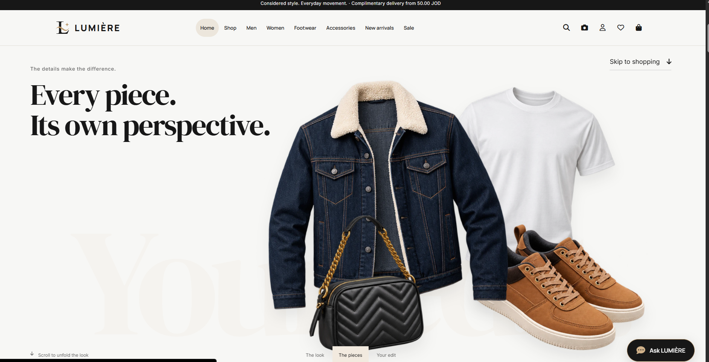
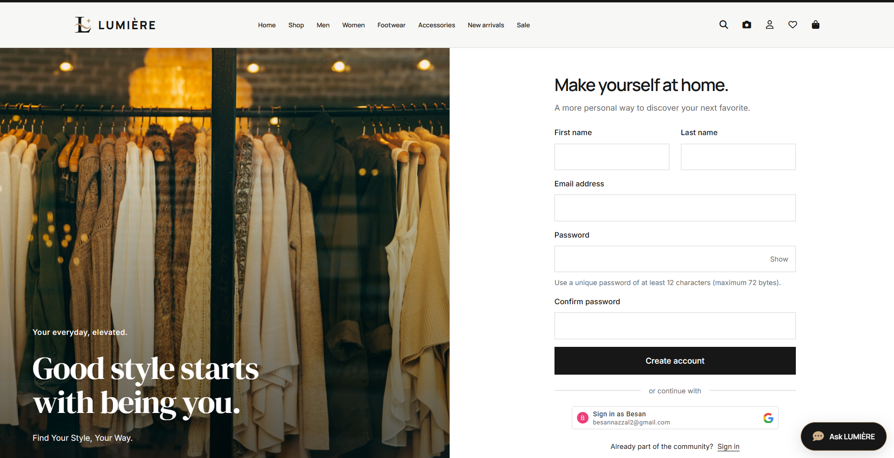
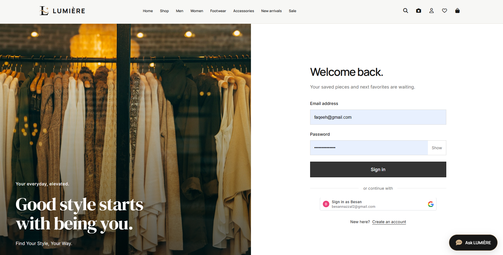
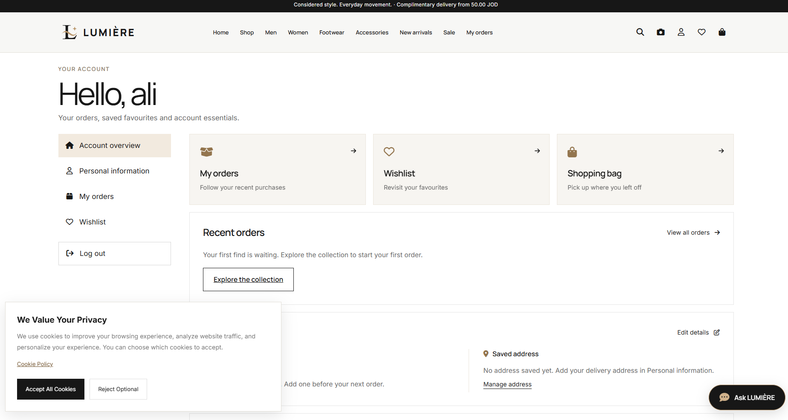
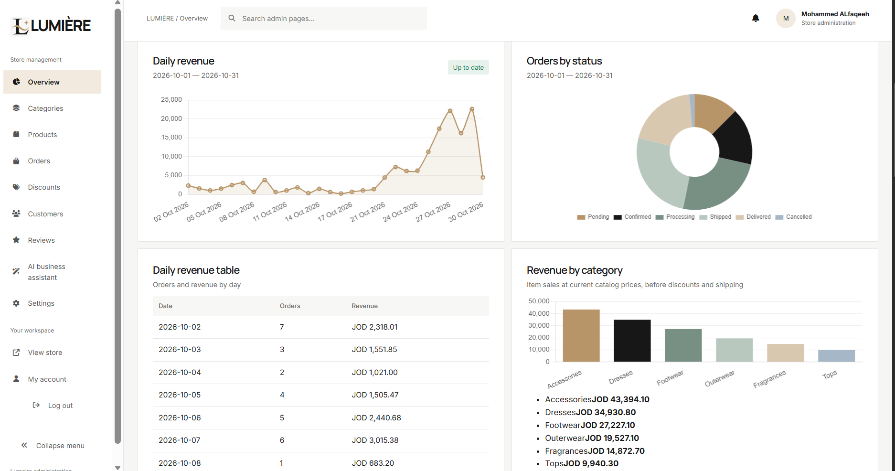
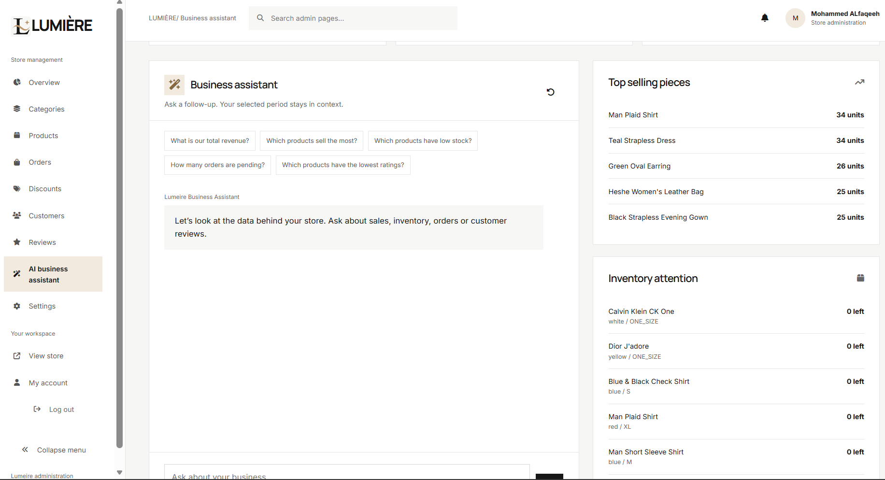
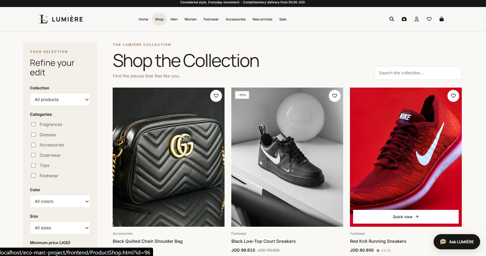
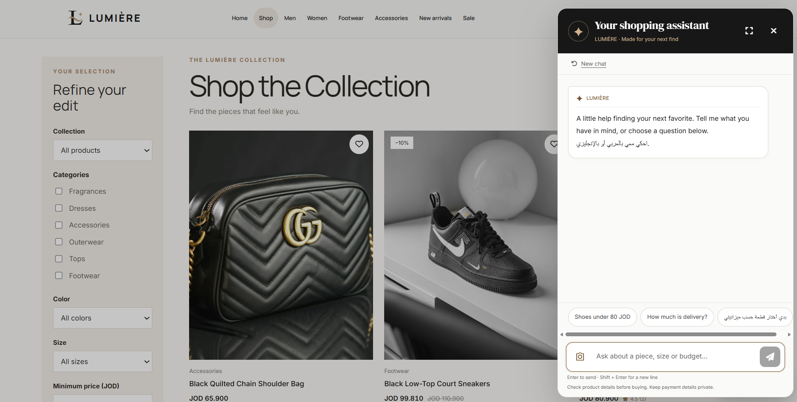
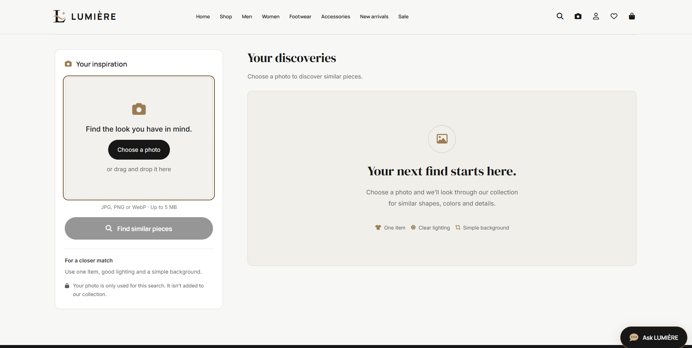

# LUMIÈRE
A modern fashion e-commerce platform with intelligent shopping experiences.
## About the Project
LUMIÈRE is a full-stack fashion e-commerce web application designed to deliver a seamless and personalized online shopping experience.

The platform allows customers to explore fashion collections, discover products, manage their shopping carts, and place orders. It also provides an administration dashboard for managing store operations and AI-powered features that enhance product discovery.

  ## 🤝 The Team
This project was developed collaboratively by our team:
* **Scrum Master:** Yousef jarrar
* **Product Owner:** Mohammed Alfaqeeh
* **Development Team:** 
  * Besan Nazzal
  * Tala Oqaili
  * Salah Qaraeen

  
## Features
### Customer Features
1-Modern and responsive fashion storefront.

2-Browse products and categories.

3-Search and filter products.

4-Product details and reviews.

5-Shopping cart and checkout.

6-Customer registration and login.

7-Wishlist management.

8-Order history.

9-AI-powered shopping assistant.

10-Visual product search using images.

### Admin Features
1-Dashboard and store statistics.

2-Product management.

3-Category management.

4-Customer management.

5-Order management.

6-Discount and promotion management.

7-Review management.

8-Store settings and AI configuration.

### AI Features
1-Image-based product search using CLIP.

2-Visual similarity matching.

3-Conversational shopping assistance.

4-Product recommendations based on available catalog information.


## 📂 Project Structure

A quick look at how we organized our code:

```text
eco-marc-project/
├── frontend/
│   ├── admin/
│   ├── account/
│   └── assets/
│       ├── css/
│       ├── js/
│       └── images/
│
├── backend/
│   ├── api/
│   ├── classes/
│   ├── config/
│   ├── middleware/
│   └── bin/
│
├── ai-service/
│
└── database/
    ├── database.sql
    └── migrations/
```

## 💻 Built With 
1- HTML, CSS, JavaScript 
2- PHP
3- MySQL
4- Cloudinary
5- Python, FastAPI, CLIP
6- Composer

## 🚀 How to Run It Locally
You don't need any complex backend environment to test this out. Just follow these steps:

1. **Clone the repository:**
    ```bash
    git clone https://github.com/yousef-jarrar/eco-marc-project.git
    ```
2. **Open the project folder:**
    ```bash
    cd Lumeire
    ```
3. **Run the app:**
    * Open the project in Visual Studio Code and use the **Live Server** extension.
    * Or, simply open the `pages/Landing.html` file directly in your web browser.

    ## 🖼️ Screenshots

### Landing Page

### Register

### Login

### Accept Cookie

### Admin overview

### Admin AI model

### Shop Page

### Chat bot



### Visual Serach AI model


## 📐 Project Documentation

- 📊 [ER Diagram](https://dbdiagram.io/d/ecommerce-6ae1cab4ed134e407e2ce1ae)
- 🎨[📄 View Wireframes](Docs/ecomarc-wireframe.pdf)
[📄 View Mockup](Docs/ecomarc-mockup.pdf)
  
    
   
     
    
    


